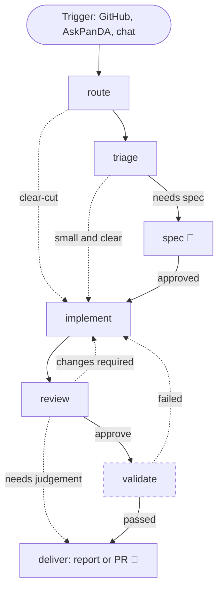

# ASPIRE Code Factory

**A**gentic **S**oftware **P**roduction, **I**ntegration, **R**eview and
**E**ngineering.

An agent-based software factory. Requests arrive from
GitHub, AskPanDA or chat, move through a blueprint of stages
(route → triage → spec → implement → review → deliver), and come out as
reviewed reports or pull requests. Humans approve specs, resolve escalations
and merge.

The core is generic and works on any repository. PanDA support comes as an
optional pack, and the **PanDA Pilot** factory is the first worked example.

## How it works

A trigger becomes a task. The **router** uses fixed rules, not a model: it
sends clear-cut work straight to implement and everything else to
**triage**. Triage sends larger or ambiguous work to **spec**, which a human
approves (👤). The builder **implements** and verifies the change. The
**reviewer**, a different model family from the builder, approves it, sends
clear problems back, or passes open questions on to a human. **Validate**
(dashed box: a possible future stage) runs the change in a real environment
next to a control run; without it, approved work goes straight to deliver.
**Deliver** produces a report, a pull request or both, and a human decides
whether to merge (👤).

Solid arrows are the main path; dashed arrows are shortcuts and loops back.
Loops are capped, every task has a budget, and any stage can escalate to a
human (not drawn). Details: [stages](docs/stages.md).

Compared with the generic factory loop this project started from, ASPIRE adds
the deterministic router, the validate stage and the report as an
alternative to a pull request, and requires an independent reviewer.

**Status:** Phase 0 — design. No code yet.

## Documentation

**Core**

| Document | What it covers |
|---|---|
| [Architecture](docs/architecture.md) | Components, deployment, security |
| [Stages](docs/stages.md) | What each stage must produce |
| [Agents](docs/agents.md) | Current agents and possible future ones |
| [Configuration](docs/configuration.md) | The `factory.yaml` format |
| [Models](docs/models.md) | Model choice, hosting and cost |
| [Data model](docs/data-model.md) | Tasks, runs, events, conversations |
| [Interfaces](docs/interfaces.md) | Runner, agent backends, API, MCP tools |
| [Extensibility](docs/extensibility.md) | Packs, factories and extension points |
| [Chat UI](docs/chat-ui.md) | The chat front end and its modes |

**PanDA**

| Document | What it covers |
|---|---|
| [PanDA pack](docs/panda-pack.md) | AskPanDA, Bamboo and test-job integrations |
| [Pilot example](docs/pilot-example.md) | The PanDA Pilot factory and CERN-PTEST validation |

**Project**

| Document | What it covers |
|---|---|
| [Decisions](docs/decisions.md) | What is decided, proposed and open |
| [Roadmap](docs/roadmap.md) | Phases and exit criteria |

## Principles

- The core is product-agnostic; domain support comes from optional packs.
- Orchestration is deterministic code; agents do the work.
- One append-only event log feeds the dashboard, audit, scoring and replay.
- Configuration is code, changed through reviewed pull requests.
- The reviewer uses a different model family from the builder.
- Agents run sandboxed, with no production credentials, and treat all
  trigger content as untrusted.

## License

Apache License 2.0 — see [LICENSE](LICENSE).